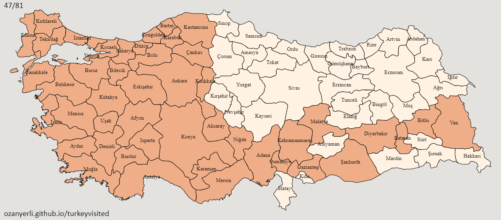

  

    <h1>Places I've visited</h1>
  

  

    <a href="#turkiye" class="trip-card trip-card--turkiye">
      

        <svg viewBox="0 0 64 64" fill="none" xmlns="http://www.w3.org/2000/svg" aria-hidden="true">
          <circle cx="32" cy="32" r="30" stroke="currentColor" stroke-width="2.5"/>
          <path d="M22 28c2-6 8-8 14-6s8 8 4 14" stroke="currentColor" stroke-width="2" stroke-linecap="round"/>
          <circle cx="28" cy="26" r="3" fill="currentColor" opacity=".3"/>
          <path d="M34 24l2-4 2 4" stroke="currentColor" stroke-width="1.5" stroke-linecap="round" stroke-linejoin="round"/>
        </svg>
      

      

        <h2 class="trip-card__title">Türkiye</h2>
        
<strong>47</strong> / 81 provinces

        
Still exploring every corner of Anatolia.

      

      →
    </a>
    <a href="#dunya" class="trip-card trip-card--dunya">
      

        <svg viewBox="0 0 64 64" fill="none" xmlns="http://www.w3.org/2000/svg" aria-hidden="true">
          <circle cx="32" cy="32" r="30" stroke="currentColor" stroke-width="2.5"/>
          <ellipse cx="32" cy="32" rx="12" ry="30" stroke="currentColor" stroke-width="1.5"/>
          <path d="M6 22h52M6 42h52" stroke="currentColor" stroke-width="1.5"/>
          <line x1="32" y1="2" x2="32" y2="62" stroke="currentColor" stroke-width="1.5"/>
        </svg>
      

      

        <h2 class="trip-card__title">The World</h2>
        
<strong>9</strong> countries

        
One step beyond the borders.

      

      →
    </a>
  

  <section class="trip-section" id="turkiye">
    <h2>🇹🇷 Turkey <small>47 / 81 provinces</small></h2>
    

  </section>

  <section class="trip-section" id="dunya">
    <h2>🌍 The World <small>9 countries</small></h2>
    

      

        &#x1F1E8;&#x1F1FF;
        

          <h3>Czechia</h3>
          
Prague

        

      

      

        🇦🇹
        

          <h3>Austria</h3>
          
Vienna

        

      

      

        🇭🇺
        

          <h3>Hungary</h3>
          
Budapest

        

      

      

        🇩🇪
        

          <h3>Germany</h3>
          
Berlin

        

      

      

        🇳🇱
        

          <h3>Netherlands</h3>
          
Amsterdam

        

      

      

        🇧🇪
        

          <h3>Belgium</h3>
          
Brussels

        

      

      

        🇩🇰
        

          <h3>Denmark</h3>
          
Copenhagen

        

      

      

        🇳🇴
        

          <h3>Norway</h3>
          
Oslo

        

      

      

        🇸🇪
        

          <h3>Sweden</h3>
          
Stockholm ×2

        

      

    

  </section>

